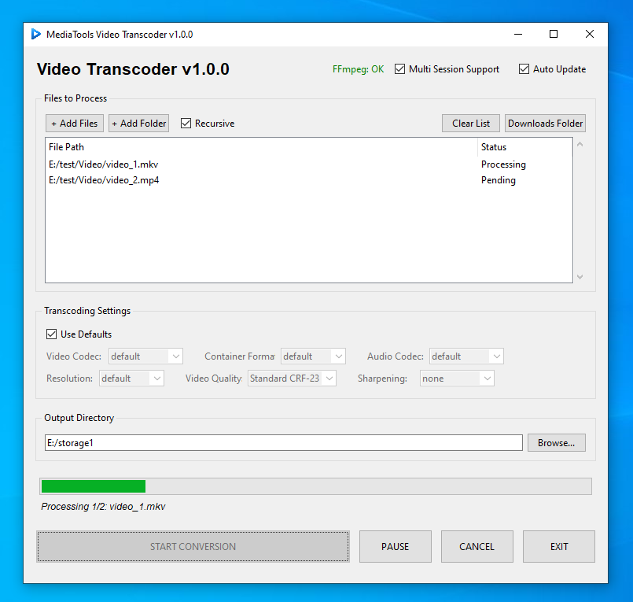

# MediaTools Video Transcoder

A powerful, cross-platform desktop application for batch video transcoding, powered by FFmpeg.

## Table of Contents

- [About](#about)
- [What's New in v1.0.0](#whats-new-in-v100)
- [Features](#features)
- [System Requirements](#system-requirements)
- [Installation](#installation)
- [Quick Start](#quick-start)
- [Command-Line Usage](#command-line-usage)
- [Docker / API](#docker--api)
- [Documentation](#documentation)
- [Dependencies](#dependencies)
- [Support](#support)
- [License](#license)
- [Legal Disclaimer](#️-legal-disclaimer)
- [Credits](#credits)

## About

MediaTools Video Transcoder is a streamlined GUI for FFmpeg that simplifies complex video conversion tasks. Whether you need to shrink file sizes, change formats for device compatibility, or apply professional sharpening filters, this tool provides a robust and intuitive interface for high-quality results.



- **Enhanced Queue Management**: New right-click context menu with **"Enqueue Again"** for Done/Error items.
- **Intelligent Logic**: Smart duplicate file detection and collision handling.
- **Stop & Cancel Refinements**: Interrupted tasks now rename partial output files with `_stopped` or `_cancelled` suffixes for clarity.
- **Dynamic CRF Labels**: The quality dropdown now shows actual CRF values specifically matched to each video codec (e.g., AV1 shows CRF-34).
- **Robust Audio Copy**: Improved mapping system ensuring original audio can be copied across more container formats with smart fallbacks.
- **Bug Fixes**: Resolved `ui_callback` errors and improved FFmpeg command transparency with console logging.

## Features

### Advanced Transcoding

- **Multiple Codec Support**: H.264, H.265 (HEVC), AV1 (SVT-AV1), and VP9.
- **Universal Containers**: MP4, MKV, AVI, WebM, and MOV.
- **Audio Logic**: Robust "Copy Original" mode with mapping support and intelligent fallbacks.
- **Professional Filters**: Integrated sharpening filters (Unsharp, CAS) for enhanced visual clarity.
- **CRF Control**: Codec-aware dynamic labels for Standard, Best, or Low quality presets.

### Intelligent Workflow

- **Batch Processing**: Add individual files or entire folders with recursive scanning.
- **Queue Persistence**: Remembers your pending tasks and settings across sessions.
- **Output Management**: Automatic collision handling (e.g., `_1`, `_2`) without overwriting original files.
- **Interactive UI**: Drag-and-drop feeling with right-click queue management.

## System Requirements

- **Operating System**: Windows 10/11, Ubuntu 20.04+
- **macOS**: Supported
- **Dependencies**:
  - `FFmpeg` (automatically managed by the application)

## Installation

1. Download the latest release for your platform.
2. Run the executable file:
   - **Windows**: `mt-vtr.exe`
   - **Linux**: `mt-vtr` (make it executable with `chmod +x mt-vtr`)
3. The application will automatically check for FFmpeg and offer to download it on the first run.

## Quick Start

1. Launch MediaTools Video Transcoder.
2. Click **+ Add Files** or **+ Add Folder** to populate your queue.
3. Select your desired **Video Codec**, **Container**, and **Resolution**.
4. Click **START CONVERSION**. Use **CANCEL** to stop a batch or **EXIT** to close the app.
5. Your files will be saved to the configured output directory (Browse to change).

## Command-Line Usage

Run the application without arguments to open the GUI. Pass arguments for
headless transcoding:

```bash
mt-vtr.exe                         # Windows: GUI
./mt-vtr                           # Linux/macOS: GUI

mt-vtr.exe -help                   # show help
mt-vtr.exe -i input.mp4            # transcode using factory defaults
mt-vtr.exe -i input.mp4 -o output  # choose output directory
mt-vtr.exe -i a.mp4 -i b.mp4       # transcode multiple files
mt-vtr.exe -i input.mp4 --use-saved-settings  # reuse GUI last-used settings
```

From a source checkout:

```bash
PYTHONPATH=src python3 -m video_transcoder -help
PYTHONPATH=src python3 -m video_transcoder -i input.mp4
```

After `pip install -e .`, the `video-transcoder` console command is also
available. The project uses the usual Python naming convention: the
distribution/console command is `video-transcoder`, while the import package is
`video_transcoder` because Python module names cannot contain hyphens.

CLI mode never opens Tk windows. FFmpeg update checks and queue prompts are
GUI-only; if FFmpeg is missing, the CLI prints an error unless you authorize a
download with `--download-ffmpeg`. Existing output files receive unique names
instead of prompting.

CLI transcoding uses factory defaults unless options override them; add
`--use-saved-settings` to reuse the GUI's last-used codec/container/quality
choices. The default output directory comes from the app settings. Packaged
builds write outputs to a `transcoded` folder next to `mt-vtr` when that
location is writable. Otherwise they fall back to the per-user directory, for
example `%LOCALAPPDATA%\MediaTools\Video Transcoder\transcoded` on Windows or
`~/.local/share/MediaTools/Video Transcoder/transcoded` on Linux. Choosing an
output folder in the GUI overrides this default and is saved for later runs.

The portable onedir folder is fully portable when `_internal/portable.flag`
exists. In that mode settings, the queue, and downloaded FFmpeg binaries live
under `_internal/data` and `_internal/bin`; no AppData/Local directory is
created. The onefile executable does not use this mode because its `_internal`
bundle is temporary, so it keeps settings in the per-user data directory.

## Docker / API

The Docker image exposes the same transcoding engine through a FastAPI service
and a browser UI. The desktop and Docker builds share `src/video_transcoder/core`,
so codec, audio, container, and FFmpeg behavior stay consistent.

```bash
# Build from the repository root
docker build -f docker/video-transcoder/Dockerfile -t video-transcoder:local .

# Run with persistent storage
mkdir -p docker/video-transcoder/storage/{uploads,outputs,temp}
docker run --rm -p 8000:8000 \
  -v "$(pwd)/docker/video-transcoder/storage:/storage" \
  video-transcoder:local
```

Open <http://localhost:8000>; API docs are at `/docs` and `/redoc`. See
[docker/video-transcoder/README.md](docker/video-transcoder/README.md) for
configuration, Compose usage, and storage permissions. The Docker workflow
publishes branch tags and, on `main`, `latest` plus a version tag.

## Documentation

For detailed usage instructions and troubleshooting:

- See **UserGuide.md** in the `docs/` folder.
- Access the **Walkthrough** for a feature-by-feature tour.
- Complete documentation: [docs/UserGuide.md](docs/UserGuide.md)

## Development

This repository uses a standalone `src/` layout:

```text
src/video_transcoder/
├── app/          # Tk bootstrap and lifecycle
├── api/          # FastAPI service and browser UI (Docker)
├── core/         # transcoder engine and batch service
├── ffmpeg/       # FFmpeg binary management
├── gui/          # main window
├── settings/     # settings and path resolution
├── system/       # desktop-shortcut helpers
└── utils/        # shared helpers
assets/           # UI icons (shipped)
bin/              # FFmpeg binaries (runtime, not tracked)
data/             # settings and queue (runtime, not tracked)
scripts/          # dev-only cleanup helpers
packaging/        # PyInstaller build scripts
docker/           # Dockerfile, Compose, and container docs
```

Run from source:

```bash
pip install -r requirements.txt
PYTHONPATH=src python3 -m video_transcoder
```

Run the test suite:

```bash
PYTHONPATH=src python3 -m unittest discover -s tests
```

API tests are skipped unless the API extras are installed:

```bash
python3 -m pip install -e ".[api]" httpx
PYTHONPATH=src python3 -m unittest tests.test_api -v
```

## Dependencies

This application uses:

- **FFmpeg**: Media processing engine ([https://ffmpeg.org](https://ffmpeg.org))

FFmpeg is automatically downloaded and managed by the application to ensure compatibility.

## Support

For issues, questions, or feature requests:

- **GitHub Issues**: [https://github.com/MediaTools-tech/mediatools/issues](https://github.com/MediaTools-tech/mediatools/issues)
- **Website**: [mediatools.tech](https://mediatools.tech)

## License

This project is licensed under the MIT License - see the [LICENSE](LICENSE) file for details.

## ⚠️ Legal Disclaimer

This software is a GUI tool for FFmpeg. Users are solely responsible for ensuring they have the legal right to transcode and distribute the media files processed by this application.

## Credits

- **Developed by**: Bala
- **Organization**: MediaTools
- **Website**: [mediatools.tech](https://mediatools.tech)

---

**Version**: 1.0.0  
Copyright (c) 2026 MediaTools. All rights reserved.
